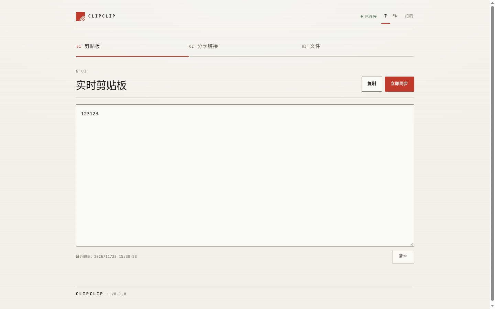
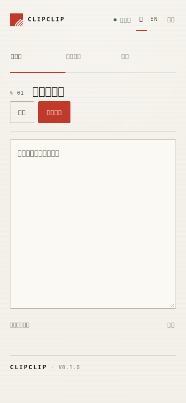

<p align="center">
  
</p>

# ClipClip

[](https://github.com/zqs1qiwan/ClipClip/stargazers) [](LICENSE) [](https://hub.docker.com/r/zqs1qiwan/clipclip) [](https://hub.docker.com/r/zqs1qiwan/clipclip)

English · [简体中文](README.md)

A self-hosted web clipboard: live text sync, immutable share links, and small file drops. No client app — just a browser.

`LOCAL-FIRST · ZERO-DEPENDENCY · ONE CONTAINER`

|  |  |
| --- | --- |

---

## Features

- **Live clipboard** — Open the same page on multiple devices; text syncs live and typing auto-saves.
- **Share links** — Immutable text links with optional expiry, burn-after-read and passphrase.
- **File drop** — Upload a small file, download it on another device; one-line `curl` upload supported.
- **QR pairing** — Tap Scan in the top bar and open it with your phone camera.
- **Two modes** — Zero-setup on a trusted LAN; token auth required when exposed publicly.

## Quick start (Docker, recommended)

```bash
mkdir -p /srv/clipclip/data && chown -R 1000:1000 /srv/clipclip/data
docker run -d --name clipclip --restart unless-stopped \
  -p 5678:5678 -v /srv/clipclip/data:/data \
  zqs1qiwan/clipclip:latest
```

Open `http://<host-ip>:5678`. Image: [Docker Hub zqs1qiwan/clipclip](https://hub.docker.com/r/zqs1qiwan/clipclip); tags `:latest` (newest) / `:0.1.0` (pinned).

**Run locally** (Node.js 22+): `npm start` → `http://localhost:5678`.
**Docker Compose**: grab [docker-compose.yml](docker-compose.yml) and run `docker compose up -d`; all settings in [.env.example](.env.example).

## About the volume / `-v`

`-v /srv/clipclip/data:/data` maps the container's `/data` to a host directory — **strongly recommended**:

- Clipboard text, share links and uploaded files survive container removal or upgrades (persistence).
- `/data` holds `state/clipclip-state.json` (metadata) and `uploads/` (file blobs).
- The container runs as non-root (uid 1000), so a bind-mounted directory needs `chown -R 1000:1000` first.
- Back up by archiving `/srv/clipclip/data`. Running **without a volume works**, but all data is lost when the container is removed.
- You can also use a named volume `-v clipclip-data:/data` (Docker-managed, no chown needed).

## Limits and retention

| Item | Default | Environment variable |
| --- | --- | --- |
| Max upload size per file | 50 MB | `CLIPCLIP_MAX_UPLOAD_MB` |
| Live clipboard text limit | 100000 bytes | `CLIPCLIP_LIVE_CONTENT_LIMIT` |
| Paste body limit | 524288 bytes | `CLIPCLIP_PASTE_CONTENT_LIMIT` |
| Paste TTL | 24 hours | `CLIPCLIP_PASTE_TTL_HOURS` |
| File TTL | 24 hours | `CLIPCLIP_FILE_TTL_HOURS` |
| Max paste TTL | 168 hours (7 days) | `CLIPCLIP_PASTE_TTL_MAX_HOURS` |
| Recent files kept | 10 | `CLIPCLIP_RECENT_FILES_LIMIT` |

Expired pastes and files are cleaned up automatically.

## Two modes

| | Local (default) | Public |
| --- | --- | --- |
| Enable | Leave `CLIPCLIP_ACCESS_TOKEN` unset | Set it to a strong token |
| Login | None — just open the page | Token required |
| Use case | Trusted LAN | Internet |

For public exposure, always put Cloudflare Access or an authenticating reverse proxy in front — see [Security](docs/SECURITY.md).

## Usage

- The home page is the clipboard; typing auto-syncs. Buttons: Copy / Sync now / Clear.
- Share link: enter text, set expiry / burn-after-read / passphrase, then copy the link.
- Files: drag and drop to upload; CLI: `curl -F "file=@notes.txt" http://<host>:5678/api/files`.
- CLI download: `curl -OJ http://<host>:5678/api/files/<id>/download`.

Full API: [docs/API.md](docs/API.md). PWA "Add to Home Screen" requires HTTPS or localhost.

## Documentation

[API](docs/API.md) · [Security](docs/SECURITY.md) · [Architecture](docs/ARCHITECTURE.md) · [PRD](docs/PRD.md) · [Roadmap](docs/ROADMAP.md)

MIT license · [LICENSE](LICENSE)
