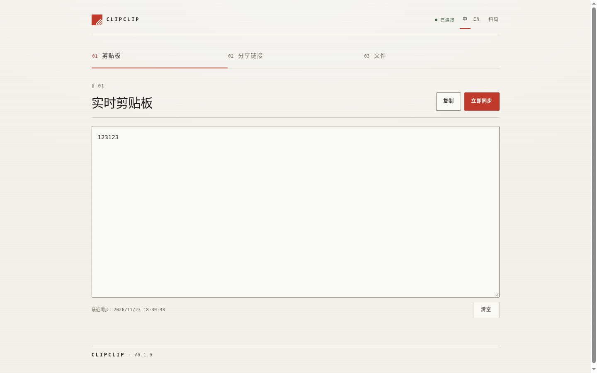
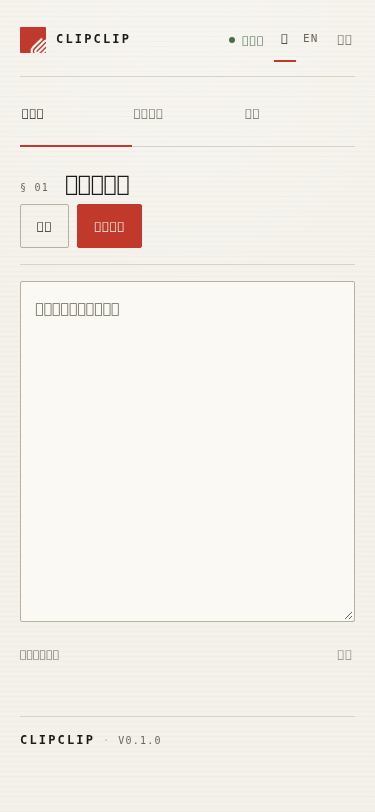

# ClipClip

<p style="font-family: 'Iowan Old Style', 'Palatino Linotype', Palatino, 'Songti SC', Georgia, serif; font-size: 2rem; line-height: 1.2;">
A small, sharp tool for moving text and files between your devices.
</p>

`LOCAL-FIRST · ZERO-DEPENDENCY · DOCKER-READY · MIT`

---

## What

ClipClip is a self-hosted web clipboard. Open one page on your devices: text you write is shared live, paste links are immutable, and small files move from one machine to another without a third-party service.

It runs as a single Node.js process, directly on a host (`npm start`) or as one Docker container with persistent data under `/data`. There is no database, no package install at runtime, and no client app to distribute — a modern browser is enough.

Screenshots (light theme):

| Desktop | Mobile |
| --- | --- |
|  |  |

## Why

Moving a command, token, snippet, or small file between a phone, a laptop, and a home server usually means a cloud clipboard, a messaging app, or a USB stick. ClipClip keeps that traffic on infrastructure you control.

- Local mode assumes a trusted LAN and asks nothing of you — no account, no login, no setup beyond starting the process.
- When the tool must be reachable from the internet, public mode adds a token gate and is designed to sit behind Cloudflare Access or an authenticating reverse proxy.
- The interface is a working surface, not a landing page: the clipboard is the first thing you see.

## Quick start

Local mode is the default: one process, LAN access, no authentication. Use it only on a trusted network.

**Requirements:** Node.js 22 or newer (local mode); for containers, a Linux host with Docker Engine 24+ and Docker Compose v2.20+, and a writable data directory mounted at `/data`.

```bash
npm start            # single process on 0.0.0.0:5678
# or, during development, with file watching:
npm run dev
```

Open `http://localhost:5678` (or `http://<host-ip>:5678` from another device). Stop with `Ctrl+C`. Runtime data is written to `./data` unless `CLIPCLIP_DATA_DIR` points elsewhere.

### CLI quick examples (curl)

The API is script-friendly. In local mode no auth is needed; in public mode add `-H "Authorization: Bearer $CLIPCLIP_ACCESS_TOKEN"` to each call (or use `-b cookies.txt` after `POST /api/login`). See [docs/API.md](docs/API.md) for the complete reference.

```bash
BASE=http://127.0.0.1:5678

# read / write the live clipboard
curl -fsS "$BASE/api/live"
curl -fsS -X PUT -H 'content-type: application/json' \
  -d '{"content":"hello from CLI"}' "$BASE/api/live"

# create a paste, then read it
curl -fsS -H 'content-type: application/json' \
  -d '{"content":"fixed text"}' "$BASE/api/pastes"
curl -fsS "$BASE/api/pastes/<id>"

# upload a file (raw body or multipart) and download it
curl -fsS -X POST -H 'X-File-Name: notes.txt' --data-binary @notes.txt "$BASE/api/files"
curl -fsS -F "file=@notes.txt" "$BASE/api/files"
curl -OJ -fsS "$BASE/api/files/<id>/download"    # -OJ keeps the server filename
```

### Docker deployment (recommended)

#### Fastest start — use the published image

A Linux amd64 image is published on Docker Hub as [`zqs1qiwan/clipclip`](https://hub.docker.com/r/zqs1qiwan/clipclip). No source checkout is needed:

```bash
docker run -d --name clipclip \
  --restart unless-stopped \
  -p 5678:5678 \
  -v /srv/clipclip/data:/data \
  zqs1qiwan/clipclip:0.1.0
```

Use `:latest` to follow the newest release, or pin `:0.1.0` for a stable version. On first run with a **bind mount**, make the host directory writable by the container user (`uid/gid 1000`):

```bash
mkdir -p /srv/clipclip/data && chown -R 1000:1000 /srv/clipclip/data
```

Then open `http://<host-ip>:5678`. To expose it publicly, see [Two modes](#two-modes) and [docs/SECURITY.md](docs/SECURITY.md). A complete compose example with healthcheck, hardening and environment variables is in [docker-compose.yml](docker-compose.yml); all settings are listed in [.env.example](.env.example).

#### Build from source

Alternatively, build the image yourself on a Linux host: Docker cannot reliably use a Windows SMB/UNC path as a build context or bind-mount source. The reference target is the LAN router at `192.168.2.1` (see [docs/ARCHITECTURE.md](docs/ARCHITECTURE.md)).

```bash
docker compose config -q        # validate the compose file (no container started)
docker compose build            # build clipclip:0.1.0
docker compose up -d            # start detached
```

Shortcuts: `npm run docker:build`, `npm run docker:up`, `npm run docker:down`, `npm run docker:logs`. The image is tagged `clipclip:0.1.0`; bump the tag, `package.json` `version`, and the version returned by `/api/health` together when releasing.

Verify:

```bash
docker compose ps                                     # STATUS becomes (healthy) shortly after start
curl -fsS http://127.0.0.1:5678/api/health            # {"status":"ok",...}
docker inspect --format '{{.State.Health.Status}}' clipclip
docker compose logs --tail=100
```

Healthcheck: `node scripts/healthcheck.js` probes `GET /api/health` with Node's built-in `fetch`. The Dockerfile `HEALTHCHECK` and compose `healthcheck` share the script and timings (`interval=30s`, `timeout=5s`, `retries=3`, `start_period=20s`). `restart: unless-stopped` restarts on process exit/OOM, but Docker does not restart a merely `unhealthy` container — use the health status for monitoring or a watchdog:

```cron
*/5 * * * * docker inspect --format '{{.State.Health.Status}}' clipclip | grep -q healthy || docker restart clipclip
```

Smoke-test persistence:

```bash
curl -X PUT -H 'content-type: application/json' -d '{"content":"persist-check"}' \
  http://127.0.0.1:5678/api/live
docker compose restart clipclip
curl -fsS http://127.0.0.1:5678/api/live    # still returns "persist-check"
```

Logs and lifecycle:

```bash
docker compose logs -f --tail=100   # or: npm run docker:logs
docker compose stop
docker compose down                 # keeps /data
```

Log rotation is bounded (`json-file`, 5 MB × 2 files), so a long-running container cannot fill the host disk.

#### Data persistence (`/data`)

```text
/data
  state/clipclip-state.json   JSON metadata: live clipboard, paste records, file records
  uploads/                    uploaded file blobs (newest CLIPCLIP_RECENT_FILES_LIMIT kept, TTL-based)
  tmp/                        in-flight upload staging
```

The container runs as uid/gid `1000` (user `node`). Two supported volume schemes:

- **Bind mount (default in `docker-compose.yml`)**: `./data:/data`. Host-visible and simple to back up. Own it once on the host:

  ```bash
  mkdir -p data
  sudo chown -R 1000:1000 data
  ```

  If the dataset cannot be chowned (SMB/NTFS export, NAS ACLs), add `user: "0:0"` (root, weaker isolation) or match the host owner with `user: "<uid>:<gid>"`.

- **Named volume (alternative, commented in `docker-compose.yml`)**: `clipclip-data:/data`. No host `chown` needed. The explicit volume name lives under `/var/lib/docker/volumes/clipclip-data`, so keep the Docker data root on a disk with room. `docker compose down -v` deletes this volume — never run it blindly.

Backup and restore:

```bash
# backup, bind mount
tar -czf clipclip-data-$(date +%Y%m%d).tar.gz -C data .
# backup, named volume
docker run --rm -v clipclip-data:/data -v "$PWD":/backup alpine \
  tar -czf /backup/clipclip-data.tar.gz -C /data .
# restore, bind mount (stop the container first)
docker compose stop
tar -xzf clipclip-data-YYYYMMDD.tar.gz -C data
sudo chown -R 1000:1000 data
docker compose up -d
```

`/data` holds plaintext clipboard and paste content, which may include secrets. Treat backups as secrets: encrypt at rest, restrict permissions, and never push them to public object storage.

Upgrade and rollback (back up first; the state file uses temp-file + rename so a crash does not truncate it):

```bash
docker compose build && docker compose up -d     # upgrade; /data preserved
git checkout <previous-commit>                    # rollback: rebuild prior commit/image
docker compose build && docker compose up -d
```

Without Compose:

```bash
docker build -t clipclip:0.1.0 .
docker run -d --name clipclip \
  --init --restart unless-stopped \
  --read-only --tmpfs /tmp:size=96m \
  --security-opt no-new-privileges:true --cap-drop ALL \
  --log-driver json-file --log-opt max-size=5m --log-opt max-file=2 \
  --memory 512m --cpus 1 --pids-limit 256 \
  -p 127.0.0.1:5678:5678 \
  -v "$PWD/data:/data" \
  clipclip:0.1.0
```

Named-volume variant: `-v clipclip-data:/data`. For public mode add `-e CLIPCLIP_ACCESS_TOKEN="$(openssl rand -base64 32)"` and publish `127.0.0.1:5678:5678`; never bake the token into the image.

Ports and binding:

- `CLIPCLIP_BIND_IP` (default `0.0.0.0`) is the **host** bind address. In public mode set `127.0.0.1` so LAN clients cannot bypass the front door.
- `CLIPCLIP_HOST_PORT` (default `5678`) is the host port; `CLIPCLIP_PORT` (default `5678`) is the container port.
- Keep `CLIPCLIP_HOST=0.0.0.0` inside the container when using `ports:`; binding to loopback inside makes the published port unreachable.

Hardening summary: `USER node` (non-root), `read_only: true` with writable `/tmp` tmpfs, `no-new-privileges`, `cap_drop: [ALL]`, 512 MB / 1 CPU / 256 PID limits, bounded logs, and a healthcheck.

### Development checks

```bash
npm run dev       # watch mode
npm start         # plain run
npm run build     # artifact gate: required files, index.html references, ESM imports
npm run lint      # tabs + syntax check (node --check) over src, public, scripts, tests
npm test          # node --test (temp dirs and ephemeral ports; never touches :5678)
npm run verify    # lint + build + test
```

### Troubleshooting

| Symptom | Check / fix |
| --- | --- |
| `docker compose config` fails | Compose v2.20+ required; upgrade Docker Compose |
| Container exits with `EACCES` | Bind mount not owned by uid 1000: `sudo chown -R 1000:1000 data`, or set `user:` |
| Healthcheck stays `unhealthy` | `docker compose logs`; probe: `docker exec clipclip node scripts/healthcheck.js` |
| `bind: address already in use` | Port 5678 occupied: `ss -ltnp \| grep 5678`, then set `CLIPCLIP_HOST_PORT` |
| Uploads fail with 500 | `/tmp` tmpfs too small; raise `size=` or move staging to `/data/tmp` |
| Disk usage climbing | Logs capped at 10 MB; check `du -sh data/` for uploads (TTL cleanup every `CLIPCLIP_CLEANUP_INTERVAL_MS`) |
| Container OOM-killed | Raise `deploy.resources.limits.memory`; check `docker stats` |
| SSE disconnects behind a proxy | Disable response buffering for `/api/events`, raise read timeouts, keep Cloudflare Access in front |
| `docker build` odd on a Windows share | Build on the Linux host from a local path, not an SMB/UNC mount |

## Two modes

| | Local mode (default) | Public mode |
| --- | --- | --- |
| Exposure | LAN only, `http://<host>:5678` | Internet, through Cloudflare Tunnel or a reverse proxy |
| Application auth | none, trusted LAN | `CLIPCLIP_ACCESS_TOKEN` plus a front-door authenticator |
| Extra setup | none | Access policies, tunnel ingress, optional TLS and DNS |

Public mode rules:

1. Generate a strong token and keep it out of the repository: `openssl rand -base64 32`, stored in a gitignored `.env` next to `docker-compose.yml` or in a secret manager.
2. Set `CLIPCLIP_ACCESS_TOKEN` (empty = local mode, non-empty = public mode; fixed at startup) and keep `CLIPCLIP_BIND_IP=127.0.0.1`.
3. Front the app with Cloudflare Access or an authenticating reverse proxy. The app-level session is a second layer, not a replacement for the front door.
4. Verify the checks in [docs/SECURITY.md](docs/SECURITY.md) before publishing the route.

Application-layer auth follows [docs/SECURITY.md](docs/SECURITY.md): the browser shows an embedded login view in `index.html` when the health probe reports `publicMode` and a protected API returns `401` (no separate `/login` route). `POST /api/login` sets an `HttpOnly`, `SameSite=Strict` session cookie; scripts may use `Authorization: Bearer <token>`. Static assets are public so the login UI can render; every `/api/*` data endpoint except `/api/health`, `/api/login`, `/api/logout` returns `401` without a session.

```bash
curl -i http://127.0.0.1:5678/api/live                       # 401, no data fields
curl -fsS -H "Authorization: Bearer $CLIPCLIP_ACCESS_TOKEN" http://127.0.0.1:5678/api/live
curl -fsS http://127.0.0.1:5678/api/health                   # publicMode: true
```

For Cloudflare Tunnel / reverse proxy configuration (Access application, ingress, non-buffering SSE proxy), see [docs/SECURITY.md](docs/SECURITY.md) and the deployment checklist there.

### Environment variables

Server variables (read by `src/server/config.js`):

| Variable | Default | Purpose |
| --- | --- | --- |
| `CLIPCLIP_HOST` | `0.0.0.0` | Listen address inside the container/process |
| `CLIPCLIP_PORT` | `5678` | Listen port |
| `CLIPCLIP_DATA_DIR` | `/data` (container), `./data` (local) | Data root for state and uploads |
| `CLIPCLIP_MAX_UPLOAD_MB` | `50` | Per-file upload limit |
| `CLIPCLIP_RECENT_FILES_LIMIT` | `10` | Number of recent files kept |
| `CLIPCLIP_PASTE_TTL_HOURS` | `24` | Paste expiration |
| `CLIPCLIP_PASTE_TTL_MAX_HOURS` | `168` | Upper bound for client-supplied `expiresInHours` (7 days) |
| `CLIPCLIP_PASTE_CONTENT_LIMIT` | `524288` | Max paste body (bytes) |
| `CLIPCLIP_MAX_PASTE_PASSPHRASE_LEN` | `128` | Max passphrase length (1–128) |
| `CLIPCLIP_REVEAL_RATE_LIMIT` | `5` | Failed reveal attempts per `IP + pasteId` per window |
| `CLIPCLIP_REVEAL_RATE_WINDOW_MS` | `60000` | Reveal rate-limit window (ms) |
| `CLIPCLIP_FILE_TTL_HOURS` | `24` | File expiration |
| `CLIPCLIP_CLEANUP_INTERVAL_MS` | `60000` | Expired-data cleanup interval |
| `CLIPCLIP_LIVE_CONTENT_LIMIT` | `100000` | Max live clipboard payload (bytes) |
| `CLIPCLIP_MAX_SSE_CLIENTS` | `100` | Concurrent SSE connection cap |
| `CLIPCLIP_SSE_HEARTBEAT_MS` | `25000` | SSE keep-alive interval |
| `CLIPCLIP_SSE_IDLE_TIMEOUT_MS` | `300000` | Close idle SSE connections after this long |
| `CLIPCLIP_PUBLIC_BASE_URL` | empty | Reserved for absolute link generation; not used by the current server |
| `CLIPCLIP_ACCESS_TOKEN` | unset/empty | Public-mode token: empty = local mode, non-empty = public mode (frozen at startup; never commit it) |
| `CLIPCLIP_SESSION_TTL_SECONDS` | `86400` | Session cookie / server session lifetime (seconds) |
| `CLIPCLIP_TRUST_PROXY` | `0` | `1`/`true` = derive client IP from `X-Forwarded-For` for rate limiting. Only behind a trusted proxy/Tunnel that overwrites XFF; never when directly exposed. |

Deployment-only variables (consumed by `docker-compose.yml`, not passed into the container): `CLIPCLIP_BIND_IP` (default `0.0.0.0`) and `CLIPCLIP_HOST_PORT` (default `5678`). Healthcheck overrides: `CLIPCLIP_HEALTHCHECK_HOST` (default `127.0.0.1`) and `CLIPCLIP_HEALTHCHECK_TIMEOUT_MS` (default `4000`).

## Features

- Live clipboard sync across open browser tabs and devices
- Immutable paste links with expiration; optional passphrase protection and burn-after-read
- Small file upload and download (curl-friendly: raw body or `multipart/form-data`)
- QR 扫码 / Scan QR for quick phone pairing: encodes the instance URL only — no token or clipboard content; a scanned public-mode session still needs login
- PWA 添加到主屏 / Add to home screen: static-assets-only service worker (never `/api/*`); registers in secure contexts (HTTPS/localhost), with offline caching disabled on plain-HTTP LAN
- 阅后即焚 / Burn after read: a paste is deleted on its first successful read; later reads return `404`
- 访问口令 / Passphrase: only a hash is stored; the paste body is withheld until the correct passphrase is supplied
- Single-container Docker deployment with a persistent `/data` volume
- Hardened container defaults: non-root user, read-only root filesystem, dropped capabilities, healthcheck, bounded logs, resource limits

The full HTTP API — endpoints, authentication, curl examples, and the passphrase/rate-limit semantics — is in [docs/API.md](docs/API.md).

## Design

ClipClip follows a **paper-and-ink editorial** style: a warm paper ground, fine rules instead of heavy shadows, ink-black text, a serif display face for the few large lines, and monospace for labels and metadata. A single vermilion accent is used sparingly, like a stamp or a margin note. The interface is laid out as a small tool manual — numbered sections, generous margins, content first — not a marketing page.

See [docs/BRAND.md](docs/BRAND.md) for the color palette, type stack, component language, and brand assets.

## Docs

- [API reference](docs/API.md) — endpoints, auth, curl examples
- [Security contract](docs/SECURITY.md) — two modes, headers, rate limits, deployment checklist
- [Architecture](docs/ARCHITECTURE.md) — components, state, deployment model
- [Product requirements](docs/PRD.md) — objectives, scope, decisions
- [MVP / iteration tasks](docs/MVP-TASKS.md) — implementation status
- [Roadmap](docs/ROADMAP.md) — audit findings and prioritized backlog
- [Brand & visual design](docs/BRAND.md) — paper-and-ink design system
- [Product insights](docs/PRODUCT-INSIGHTS.md) — interaction principles
- [Iteration 2 contract](docs/ITERATION-2.md) — feature expansion specification

## License

MIT. See [LICENSE](LICENSE).
